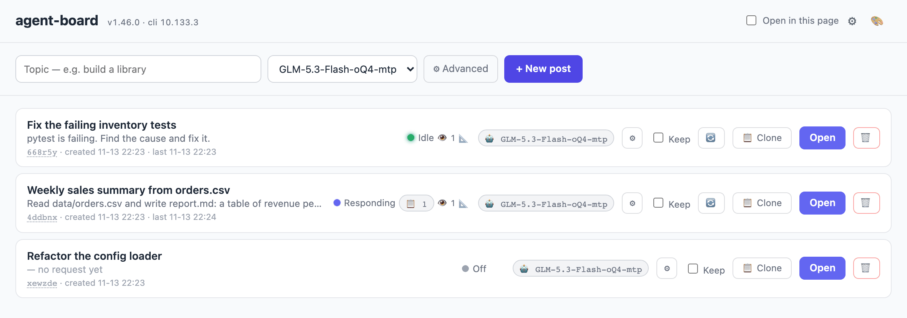
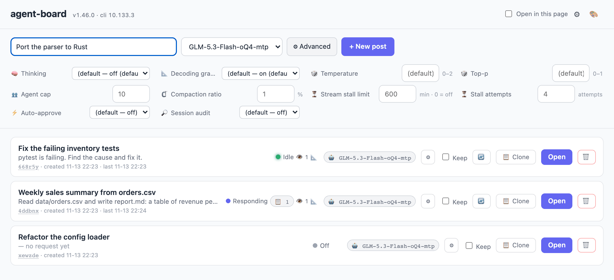
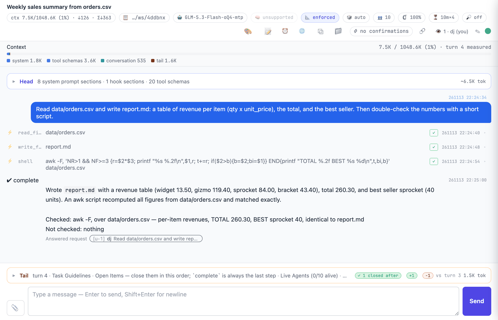

# agent-board

[agent-cli](https://github.com/dujeonglee/agent-cli) 방들의 게시판이다.
글 하나가 방 하나다 — agent-cli 세션 하나, 워크스페이스 하나, 주제 하나.
글을 열면 그 방의 agent-cli 웹 화면으로 들어간다.
방은 열 때 뜨고, 아무도 보지 않으면 스스로 꺼진다.
다시 열면 대화를 이어서 뜬다.



카드 하나가 글 하나다.
카드에는 상태(`Idle`·`Responding`·`Off` …), 👁 접속자 수, 칩이 붙는다.
위 그림에서 첫 글은 대기 중, 둘째 글은 응답 중이고 열린 항목 칩(📋 1)이 있다. 셋째 글은 꺼져 있다.

## 요구사항

- Python 3.10 이상
- PATH 에 `agent-cli` (≥ 10.121.0 권장 — 그보다 낮으면 카드의 일부 표시가 빠진다.
  버전별 기능은 [REFERENCE](docs/REFERENCE.md#agent-cli-버전별-기능))
- agent-cli 의 `models.json` 에 dialect 가 정해진 모델이 하나 이상

## 설치 · 실행

```bash
pip install "git+ssh://git@github.com/dujeonglee/agent-board.git"
agent-board          # → http://localhost:51966
```

글과 워크스페이스는 실행한 디렉터리의 `./data` 아래에 쌓인다.
포트와 데이터 자리는 환경변수로 바꾼다.

```bash
AGENT_BOARD_PORT=8080 AGENT_BOARD_HOME=~/agent-board-data agent-board
```

보드는 기본으로 `127.0.0.1` 에만 열린다.
다른 기기에서 쓰려면 [DEPLOY.md](docs/DEPLOY.md) 를 본다.
환경변수 전부는 [REFERENCE](docs/REFERENCE.md#환경변수) 에 있다.

## 사용

### 1. 글 만들기



1. 주제를 적는다.
2. 모델을 고른다. dialect 가 정해진 모델만 목록에 나온다.
3. `⚙ Advanced` 는 선택이다. 사고·문법·샘플링·에이전트 상한·자동 승인 같은 노브가 펼쳐진다.
   비워 두면 agent-cli 기본값을 쓴다.
4. `+ New post` 를 누른다. 빈 워크스페이스가 함께 만들어진다.

노브는 만들 때 한 번만 준다. 그 뒤에는 방 안의 칩에서 바꾼다.

### 2. 방 열기



`Open` 을 누르면 새 탭에 그 방의 agent-cli 웹 화면이 열린다.
헤더의 `Open in this page` 를 켜면 지금 탭에서 연다.
방 안에서 하는 일은 [agent-cli README](https://github.com/dujeonglee/agent-cli#readme) 를 본다.

### 3. 카드 읽기

| 표시 | 뜻 |
|---|---|
| `Responding` | 모델이 답을 만드는 중 |
| `Checking result` | 방금 끝난 런의 결과를 확인하는 중 |
| `Agents working` | 방의 에이전트가 일하는 중 (main 은 비어 있다) |
| `Idle` | 방이 떠 있고 기다리는 중 |
| `Off` | 방이 꺼져 있다. `Open` 하면 뜬다 |
| `❗ Needs your reply` | 방이 사람의 답을 기다린다 |
| `👁 N` | 지금 방을 보고 있는 사람 수 |
| `🤖 모델` | 방이 쓰는 모델 |
| `🤖 N/M` | 방의 에이전트 — 일하는 수 / 전체 |
| `⏰ N` | 방의 예약 수. 누르면 방이 열린다 |
| `📋 N` | 모델이 아직 처리하지 않은 열린 항목 수 |
| `🧵 N` | 방에서 돌고 있는 백그라운드 작업 수 |

배지와 칩 전부는 [REFERENCE](docs/REFERENCE.md#카드와-상태) 에 있다.

### 4. 관리

- `🔄` — 떠 있는 방을 다시 띄운다. 대화는 이어진다. 새로 깐 agent-cli 를 반영할 때 쓴다.
- `Keep` — 보는 사람이 없어도 방을 끄지 않는다.
- `📋 Clone` — 파일과 대화를 골라 새 글로 복사한다. 다른 모델로 이어갈 때도 쓴다.
- `🗑` — 글, 방, 워크스페이스를 지운다. 되돌릴 수 없다.
- 헤더의 `⚙` — admin 페이지. agent-cli 의 `config.json`·`models.json` 을 고친다.

## 더 보기

- [docs/REFERENCE.md](docs/REFERENCE.md) — 상태·칩·복제·예약·admin·탭 가드·환경변수·로그
- [docs/DEPLOY.md](docs/DEPLOY.md) — LAN·인증·TLS 로 내놓기 (caddy)
- [docs/DESIGN.md](docs/DESIGN.md) — 모듈·API·DB·라이프사이클 설계
- [docs/REQUIREMENTS.md](docs/REQUIREMENTS.md) — 요구사항
- [CHANGELOG.md](CHANGELOG.md) — 변경 기록
- [agent-cli](https://github.com/dujeonglee/agent-cli)

## 개발

```bash
pip install -e ".[dev]"
pytest
ruff check agent_board/ tests/ && ruff format --check agent_board/ tests/
AGENT_BOARD_BROWSER_TESTS=1 pytest tests/browser/   # 실브라우저 테스트 (playwright + chromium)
```
